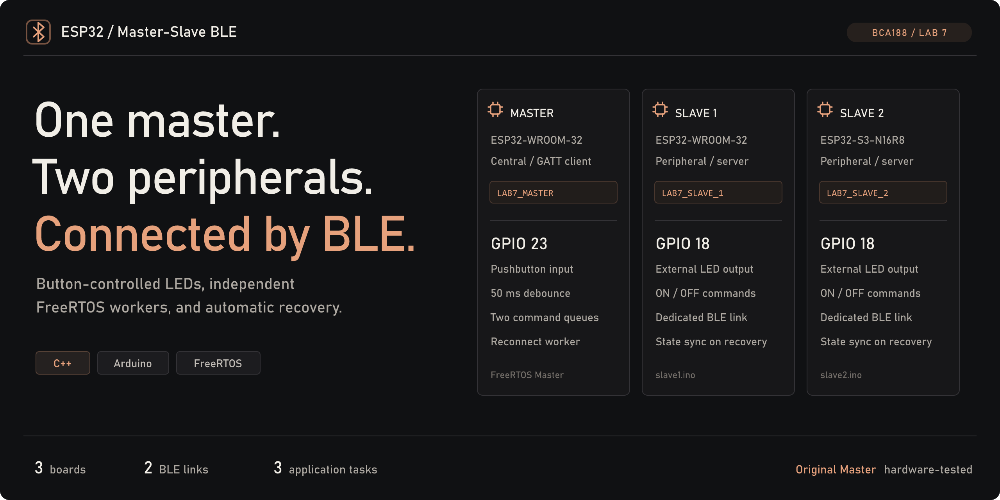
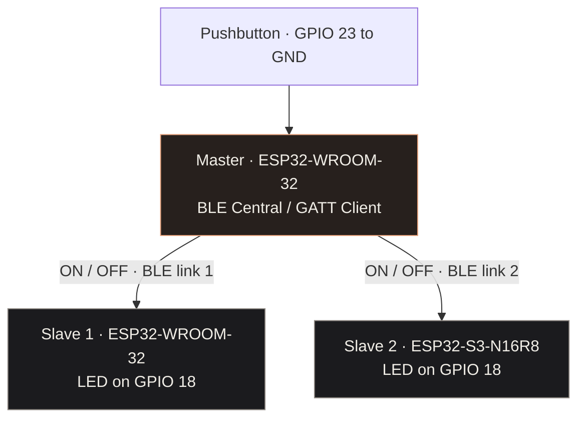
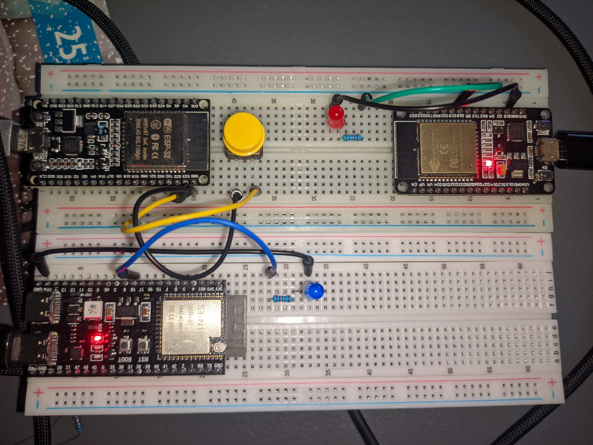
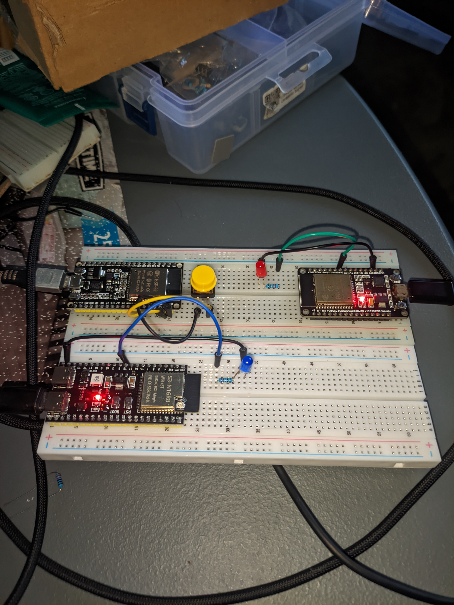
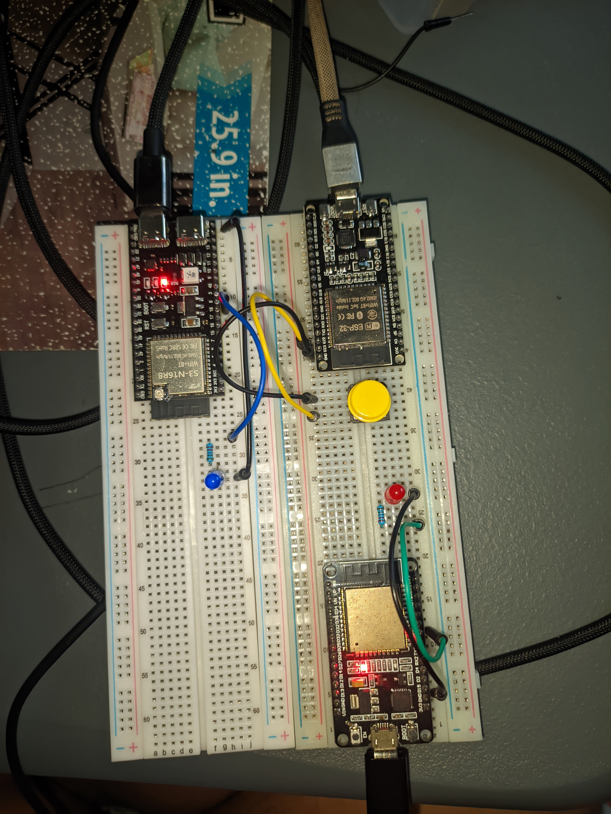

<a id="top"></a>

<p align="center">
  <picture>
    <source media="(max-width: 600px)" srcset="docs/assets/ble-cover-mobile.png">
    
  </picture>
</p>

<p align="center">
  <a href="#test-results"></a>
  <a href="#how-it-works"></a>
</p>

<p align="center">
  <strong>Explore:</strong>
  <a href="#quick-start">Quick start</a> ·
  <a href="#demonstrations">Demonstrations</a> ·
  <a href="#how-it-works">Architecture</a> ·
  <a href="#test-results">Test results</a> ·
  <a href="docs/technical-guide.md">Technical guide</a>
</p>

<p align="center">
  <a href="#quick-start"></a>
  <a href="#quick-start"></a>
  <a href="#quick-start"></a>
</p>

<p align="center">
  <a href="#firmware"></a>
  <a href="#hardware"></a>
  <a href="#how-it-works"></a>
  <a href="docs/technical-guide.md#freertos-design-and-fault-tolerance"></a>
</p>

# ESP32 Master-Slave BLE

One ESP32 reads a pushbutton and controls an LED on each of two other boards over Bluetooth Low Energy. Hold the button for `ON`; release it for `OFF`. Separate FreeRTOS workers handle the two command paths while a background worker attempts reconnection.

Built for **BCA188, Laboratory Activity 7** at **Mindanao State University–Iligan Institute of Technology (MSU-IIT)**.

<table>
  <tr>
    <td width="33%" align="center" valign="top">
      <a href="#firmware"><br><strong>Firmware</strong></a><br>
      <sub>Original Master, modular Master, and two Slaves</sub>
    </td>
    <td width="33%" align="center" valign="top">
      <a href="#demonstrations"><br><strong>Watch the system</strong></a><br>
      <sub>Serial Monitor and physical hardware recordings</sub>
    </td>
    <td width="33%" align="center" valign="top">
      <a href="#hardware"><br><strong>Build the circuit</strong></a><br>
      <sub>GPIO connections, wiring photos, and test evidence</sub>
    </td>
  </tr>
</table>

> [!IMPORTANT]
> The **original single-file Master is hardware-tested**. The modular Master still needs its own successful build and hardware tests. Both use the same Slave sketches.

<a id="demonstrations"></a>

##  Demonstrations

<details open>
<summary><strong>Serial Monitor demonstration</strong> · Master and both Slaves</summary>

Discovery, connections, and command logs displayed together.

https://github.com/user-attachments/assets/093fc8ef-db45-4300-9b11-532496c234f9

[Open recording](https://github.com/user-attachments/assets/093fc8ef-db45-4300-9b11-532496c234f9) · [Download original MP4](demo/01-serial-monitor-demonstration.mp4?raw=true)

</details>

<details>
<summary><strong>Physical hardware demonstration</strong> · Portrait video</summary>

Portrait recording of the three-board prototype, pushbutton, and LED outputs.

<table align="center" width="320">
  <tr>
    <td align="center" width="300">
      <video src="https://github.com/user-attachments/assets/4b69f4b7-eee0-44a6-8354-ccc0f447b353" width="300" controls="controls"></video>
    </td>
  </tr>
</table>

[Open recording](https://github.com/user-attachments/assets/4b69f4b7-eee0-44a6-8354-ccc0f447b353) · [Download original MP4](demo/02-actual-hardware-demonstration.mp4?raw=true)

</details>

<a id="quick-start"></a>

##  Quick start

The project used **Arduino IDE 2.3.10** with **esp32 by Espressif Systems 3.3.11**. BLE and FreeRTOS are included in that board package. Use **115200 baud** for all three Serial Monitors.

```sh
git clone https://github.com/xavieryyyyyy/Master-Slave-BLE.git
cd Master-Slave-BLE
```

1. **Upload the Slaves.** Open [`slave1.ino`](slave1/slave1.ino) for the black ESP32 and [`slave2.ino`](slave2/slave2.ino) for the ESP32-S3. Select the matching [board targets](#firmware) and COM ports.
2. **Upload one Master.** Start with the [hardware-tested original](master%20one%20code%20with%20freertos/master.ino) on the yellow ESP32. Keep the main `.ino` in a folder with the same name: `master/master.ino`, or `master_modular/master_modular.ino` for the modular version. Keep all modular `.h` and `.cpp` files together.
3. **Power both Slaves, then reset the Master.** Wait for discovery and both connections. Hold and release the button; both LEDs should follow.

The original startup scan takes approximately **8 seconds**; the modular version uses **5 seconds**. Compile each sketch before uploading. See the [complete installation guide](docs/technical-guide.md#installation-and-uploading) for the full sequence.

<a id="how-it-works"></a>

##  How it works



The Master debounces the button for **50 ms**, remembers the desired LED state, and updates a **one-item queue per Slave**. Each Slave has its own command task and mutex. `xQueueOverwrite()` replaces an older pending state with the newest one.

When a Slave disappears, the Master attempts discovery and reconnection in the background. On recovery, it sends the latest requested state. Recovery depends on power, advertising, scans, and BLE timeouts; no response-time guarantee has been measured.

One button controls both LEDs together. The boards communicate directly, with no phone, router, or internet connection needed during operation.

<details>
<summary><strong>BLE names, UUIDs, and command protocol</strong></summary>

| Board | BLE name |
| :--- | :--- |
| Master | `LAB7_MASTER` |
| Slave 1 | `LAB7_SLAVE_1` |
| Slave 2 | `LAB7_SLAVE_2` |

Both peripherals expose the same writable GATT characteristic:

```text
Service         ec8817e4-164d-4c5e-8f2f-9b238a1b4e23
Characteristic  e70df770-9853-4704-bd6d-d18b3f8dfdb3
```

Writing `ON` sets the Slave's GPIO 18 `HIGH`; `OFF` sets it `LOW`. The lab's Master/Slave naming corresponds to BLE Central/Peripheral roles.

[Device addresses and configuration](docs/technical-guide.md#ble-device-identities-and-gatt-configuration) · [FreeRTOS design](docs/technical-guide.md#freertos-design-and-fault-tolerance)

</details>

<a id="firmware"></a>

##  Firmware

Choose one Master implementation. Upload each Slave's own sketch to its board.

| Firmware | Source | Arduino target | Status |
| :--- | :--- | :--- | :--- |
| Original Master | [`master.ino`](master%20one%20code%20with%20freertos/master.ino) | `ESP32 Dev Module` | Hardware-tested reference |
| Modular Master | [`master_modular.ino`](master%20separate%20file%20with%20freertos/master_modular.ino) | `ESP32 Dev Module` | Build and hardware tests unconfirmed |
| Slave 1 | [`slave1.ino`](slave1/slave1.ino) | `ESP32 Dev Module` | Used with the tested original |
| Slave 2 | [`slave2.ino`](slave2/slave2.ino) | `ESP32S3 Dev Module` | Used with the tested original |

<details>
<summary><strong>Inside the modular Master</strong></summary>

| Module | Responsibility |
| :--- | :--- |
| [`Config.h`](master%20separate%20file%20with%20freertos/Config.h) | Names, UUIDs, pins, and timing |
| [`ButtonHandler.cpp`](master%20separate%20file%20with%20freertos/ButtonHandler.cpp) | Input, debounce, and queuing |
| [`BLEManager.cpp`](master%20separate%20file%20with%20freertos/BLEManager.cpp) | Scanning, connection, and recovery |
| [`RTOSTasks.cpp`](master%20separate%20file%20with%20freertos/RTOSTasks.cpp) | Two command workers and a reconnection worker |
| [`SharedState.cpp`](master%20separate%20file%20with%20freertos/SharedState.cpp) | Shared BLE objects, queues, mutexes, and desired state |

All files compile into one Master firmware image. Read the [modular setup notes](master%20separate%20file%20with%20freertos/README.md) before using it.

</details>

<a id="hardware"></a>

##  Hardware and wiring

You need two ESP32-WROOM-32 boards, one ESP32-S3-N16R8, a pushbutton, two LEDs, two **220 Ω or 330 Ω resistors**, breadboards, jumper wires, and USB data cables.

| Board | Wiring |
| :--- | :--- |
| Master | Pushbutton between **GPIO 23** and **GND**. `INPUT_PULLUP`: pressed is `LOW`. |
| Each Slave | **GPIO 18 → resistor → LED anode (+)**; LED cathode (−) to **GND**. |

Disconnect power before rewiring. Check the printed pin labels, LED polarity, and resistor on each output.

<details>
<summary><strong>View the complete hardware setup</strong></summary>

[](circuit/01-complete-hardware-setup.jpg)

</details>

<details>
<summary><strong>Inspect both wiring photographs</strong></summary>

| Wiring view 1 | Wiring view 2 |
| :---: | :---: |
| [](circuit/02-wiring-view-1.jpg) | [](circuit/03-wiring-view-2.jpg) |

</details>

<a id="test-results"></a>

##  Test results

These are the project's recorded results for the **original single-file Master**.

| Scenario | Result | Evidence |
| :--- | :--- | :--- |
| Discover and connect to both Slaves | Passed | [Connection log](evidence/evidence-01-ble-discovery-connections.png) |
| Control both LEDs with the button | Passed | [ON/OFF communication](evidence/evidence-02-normal-ble-communication.png) |
| Unplug Slave 1; keep controlling Slave 2 | Passed | [Slave 1 disconnected](evidence/evidence-03-slave1-disconnection.png) |
| Unplug Slave 2; keep controlling Slave 1 | Passed | [Slave 2 disconnected](evidence/evidence-04-slave2-disconnection.png) |
| Restore each Slave and resume control | Passed | [Automatic recovery](evidence/evidence-05-automatic-reconnection.png) |
| Reconnect while holding the button | Evidence captured; video/log confirmation pending | [State synchronization](evidence/evidence-07-led-state-synchronization.png) |

The modular Master needs separate compile, upload, control, disconnect/reconnect, and held-button tests. Latency and long-duration stability have not been measured.

[Full test procedure and logs](docs/technical-guide.md#test-procedure-and-results) · [Screenshot gallery](docs/technical-guide.md#photo-screenshot-and-video-evidence)

<a id="team-and-contributions"></a>

##  Team and contributions

| Team member | Role | Contributions |
| :--- | :--- | :--- |
| [Yestin Paraguya](https://github.com/xavieryyyyyy) | Master development and project integration | Master firmware, system integration, documentation, screenshots, demonstration videos, and supporting project work. |
| [Kenneth O. Restauro](https://github.com/kinitgwapo) | Slave development | Slave firmware and peripheral-side implementation. |
| [Regine Bermudo](https://github.com/REGINE-BERMUDO) | Slave development | Slave firmware and peripheral-side implementation. |

<a id="documentation"></a>

##  Documentation

| Guide | What you will find |
| :--- | :--- |
| [Complete technical guide](docs/technical-guide.md) | All 19 sections of the laboratory write-up |
| [Installation and uploading](docs/technical-guide.md#installation-and-uploading) | Board setup, sketch folders, upload order, and startup logs |
| [FreeRTOS and recovery](docs/technical-guide.md#freertos-design-and-fault-tolerance) | Command queues, mutexes, scanning, and timing limits |
| [Troubleshooting](docs/technical-guide.md#troubleshooting) | Build, upload, wiring, and BLE checks |
| [Development and next steps](docs/technical-guide.md#limitations-and-future-improvements) | Independent buttons, timing measurements, security, and further testing |
| [Team and contributions](docs/technical-guide.md#team-and-contributions) | Course details, team members, and individual responsibilities |

<details>
<summary><strong>References and project notes</strong></summary>

- [Espressif Arduino-ESP32 documentation](https://docs.espressif.com/projects/arduino-esp32/en/latest/)
- [Espressif's built-in BLE library](https://github.com/espressif/arduino-esp32/tree/master/libraries/BLE)
- [FreeRTOS documentation](https://www.freertos.org/Documentation/RTOS_book.html)
- BCA188 laboratory materials and classroom instructions.

The project owners have not selected a software license. Group/section and instructor details are still awaiting the team's input.

</details>

<p align="center">
  <a href="#top">Back to top</a> ·
  <a href="https://github.com/xavieryyyyyy/Master-Slave-BLE">Repository</a> ·
  <a href="docs/technical-guide.md">Technical guide</a>
</p>
