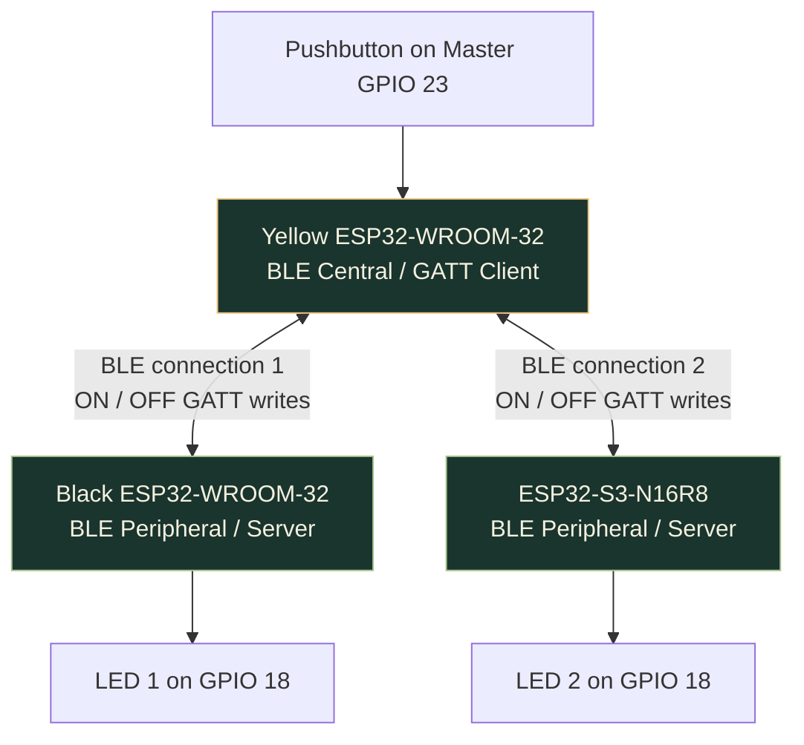
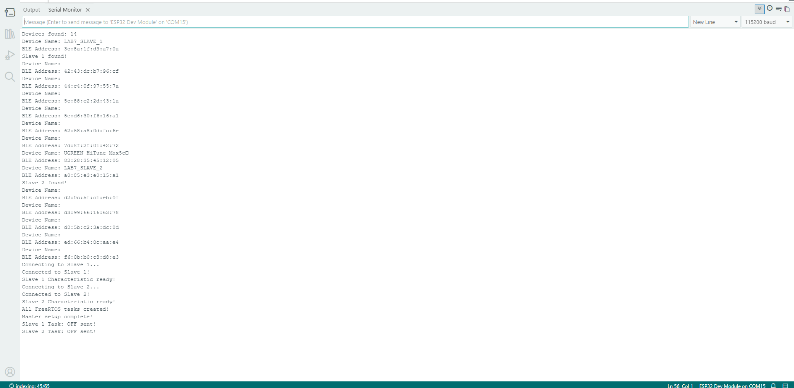
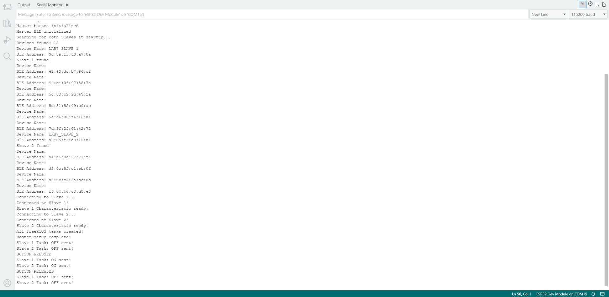
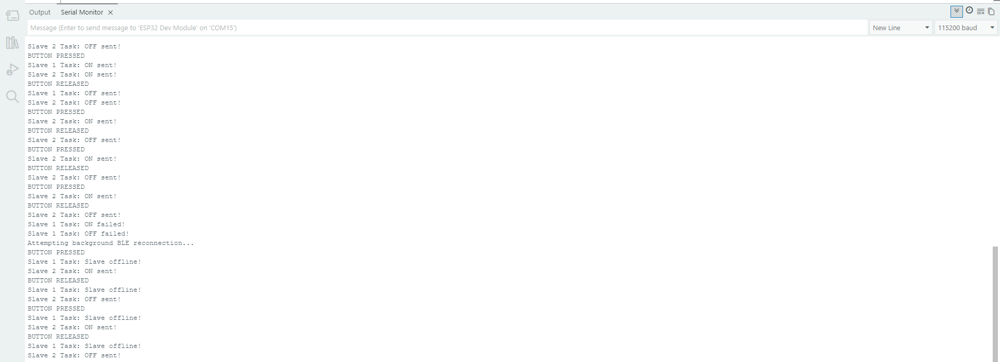
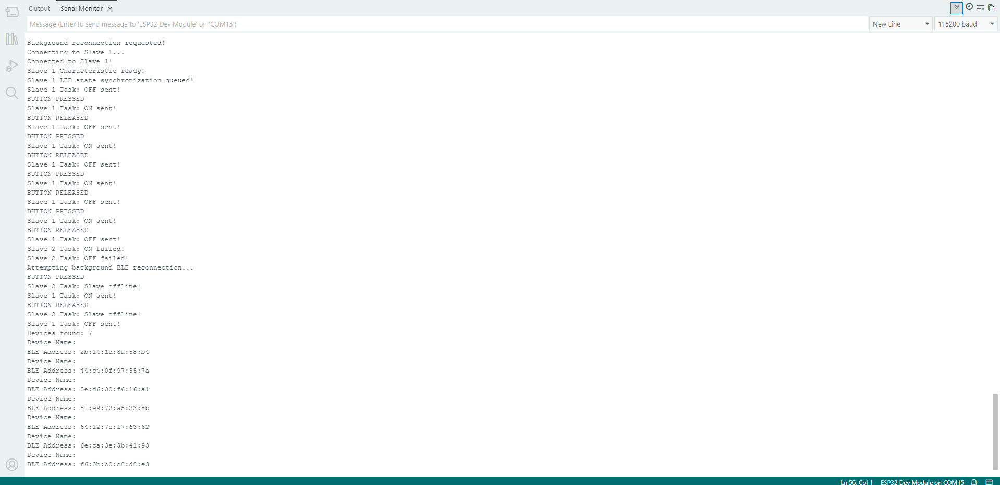
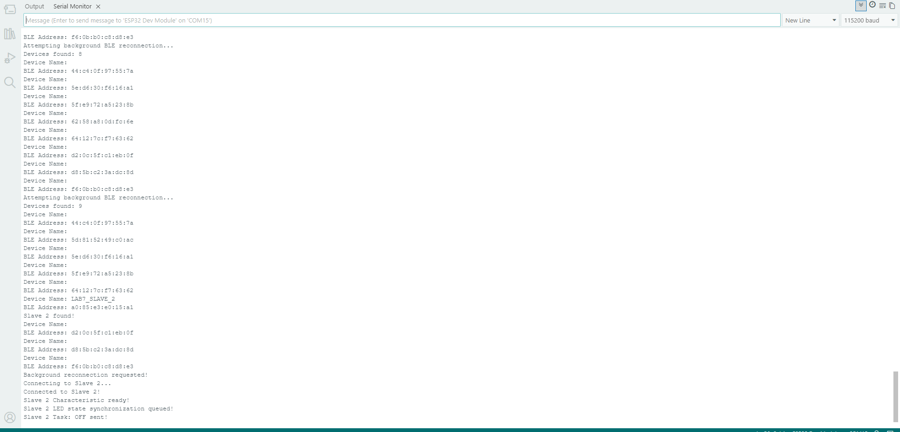
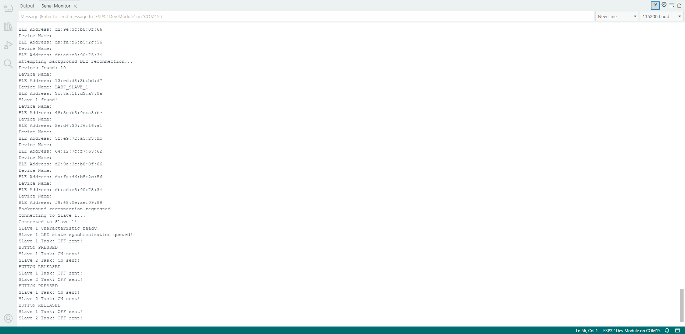

<a id="top"></a>

# ESP32 BLE technical guide

[Project README](../README.md) · [Demonstrations](../README.md#demonstrations)

<a id="project-overview"></a>

##  Project overview

One ESP32 Master reads a pushbutton and sends `ON` or `OFF` over **Bluetooth Low Energy** to two Slave boards. Each Slave drives an external LED. Hold the button to turn both LEDs on; release it to turn them off.

The yellow ESP32-WROOM-32 is the **BLE Central / GATT Client**. The black ESP32-WROOM-32 and ESP32-S3 are **BLE Peripherals / GATT Servers**. Every board reports connection events and commands through a **115200-baud Serial Monitor**.

The Master uses separate FreeRTOS command tasks and queues for each Slave. If one board disconnects, the remaining connection can keep receiving commands while the Master attempts recovery. A recovered Slave receives the latest requested LED state.

The three boards communicate directly. A phone, mobile app, Wi-Fi router, and internet connection are unnecessary during operation.

> [!IMPORTANT]
> **Hardware-tested:** original single-file Master. **Separate verification required:** modular Master, including a successful compile and equivalent tests on all three boards. The original's results do not validate the refactoring.

<a id="objectives-and-scope"></a>

##  Objectives and scope

<details>
<summary><strong>Read the project objectives</strong></summary>

- Configure **one BLE Master** and **two BLE Slaves** using actual ESP32 hardware.
- Discover nearby Slaves by advertised device name and/or recorded BLE address.
- Connect to each Slave, locate its BLE service and writable characteristic, and send GATT commands.
- Read a pushbutton using `INPUT_PULLUP` and software debouncing (`50 ms`).
- Switch each Slave's external LED **ON while the button is held** and **OFF when released**.
- Display connection state and command activity in Serial Monitor.
- Allow one connected Slave to remain usable when the other disconnects.
- Attempt automatic discovery and reconnection of an unavailable Slave.
- Explain the difference between the original single-file and modular Master codebases.
- Provide reproducible setup instructions, test evidence, wiring documentation, and a demonstration video.

**Implemented scope:** One physical button controls both LEDs together. **Independent per-Slave buttons (a proposed second button on GPIO 22)** are a future enhancement, **not** part of the currently verified firmware.

</details>

<a id="system-architecture"></a>

##  System architecture



**Terminology:** "Master/Slave" matches the laboratory title. The corresponding BLE roles are **Central/Peripheral**. The Master accesses the Slaves' **GATT Services** as a client, while each Slave hosts a GATT server.

The two Slaves have **separate BLE connections and LEDs**, but both currently receive commands generated by the **same** Master button.

<a id="hardware-and-software-requirements"></a>

##  Hardware and software requirements

### Hardware

| Quantity | Component | Role |
| :--- | :--- | :--- |
| 1 | Yellow ESP32-WROOM-32 development board | BLE Master |
| 1 | Black ESP32-WROOM-32 development board | BLE Slave 1 |
| 1 | ESP32-S3-N16R8 development board | BLE Slave 2 |
| 1 | Momentary pushbutton | Master input |
| 2 | LEDs | One output LED per Slave |
| 2 | Current-limiting resistors, **220 Ω or 330 Ω** | One per LED |
| As needed | Breadboards, jumper wires, USB cables | Prototype wiring and power |
| 1 | Computer | Arduino IDE, uploads, and serial monitoring |

### Software

- **Arduino IDE 2.3.10** (version used for development; other compatible versions may work).
- **esp32 by Espressif Systems**, board package **3.3.11** (tested environment).
- Built-in ESP32 Arduino BLE headers (`BLEDevice.h`, `BLEScan.h`, `BLEClient.h`, `BLEServer.h`, `BLEUtils.h`) and FreeRTOS headers.
- USB serial drivers appropriate for the connected development boards.
- Serial Monitor setting: **115200 baud**.
- Git/GitHub for version control and project submission.

No separate third-party BLE library is required for these sketches when using the stated Espressif ESP32 board package.

<a id="circuit-connections"></a>

##  Circuit connections

### Master: pushbutton

| Connection | Wire to |
| :--- | :--- |
| One electrically distinct button terminal | Master **GPIO 23** |
| Opposite button terminal | Master **GND** |

The Master configures `GPIO 23` as `INPUT_PULLUP`. **Released = HIGH** and **pressed = LOW**. No external button pull-up resistor is needed for this arrangement. The firmware applies **50 ms software debounce**.

### Slave 1 and Slave 2: external LED

Use this wiring **on each Slave board**:

```text
ESP32 GPIO 18 ---- 220-330 Ω resistor ---- LED anode (+)
ESP32 GND -------------------------------- LED cathode (-)
```

| Board | GPIO output | Load |
| :--- | :--- | :--- |
| Slave 1 (ESP32-WROOM-32) | GPIO 18 | LED 1 and current-limiting resistor |
| Slave 2 (ESP32-S3-N16R8) | GPIO 18 | LED 2 and current-limiting resistor |

**Safety:** Disconnect power before rewiring. Always use a suitable current-limiting resistor with a conventional LED. Verify the actual pin labels and LED polarity on your boards.

See the [three hardware and wiring photos](#photo-screenshot-and-video-evidence) alongside the electrical connections above.

<a id="ble-device-identities-and-gatt-configuration"></a>

##  BLE device identities and GATT configuration

### BLE device names and observed addresses

| Role | Advertised BLE name | Recorded BLE address | Arduino board selection |
| :--- | :--- | :--- | :--- |
| Master | `LAB7_MASTER` | `58:2a:bd:d4:92:9e` | `ESP32 Dev Module` |
| Slave 1 | `LAB7_SLAVE_1` | `3c:8a:1f:d3:a7:0a` | `ESP32 Dev Module` |
| Slave 2 | `LAB7_SLAVE_2` | `a0:85:e3:e0:15:a1` | `ESP32S3 Dev Module` |

These addresses were recorded from the project hardware. They identify **these particular boards**, not all ESP32 devices; other users must use their own discovery results or update any hardcoded address fallbacks.

### Shared GATT identifiers

Both Slaves expose the same kind of service/characteristic. Their **BLE device identities differ**, allowing the Master to connect to each one independently.

| Item | UUID |
| :--- | :--- |
| Service | `ec8817e4-164d-4c5e-8f2f-9b238a1b4e23` |
| Writable characteristic | `e70df770-9853-4704-bd6d-d18b3f8dfdb3` |

### Command protocol

| Event at Master | Text written to each connected Slave | Slave behavior |
| :--- | :--- | :--- |
| Button pressed | `ON` | Drive its LED output HIGH (LED ON) |
| Button released | `OFF` | Drive its LED output LOW (LED OFF) |
| Slave reconnects | Latest remembered desired state (`ON` or `OFF`) | Match current button state |

The Slaves use a writable **GATT characteristic** with `PROPERTY_WRITE`. Each Slave handles incoming writes in a BLE characteristic callback, updates **GPIO 18**, and prints the received command and LED state.

<a id="how-the-system-works"></a>

##  How the system works

### Startup sequence

1. Supply power to both Slaves. They initialize their GATT servers and start advertising `LAB7_SLAVE_1` and `LAB7_SLAVE_2`.
2. Start/reset the Master. It initializes serial output, BLE, button input, and FreeRTOS resources.
3. The Master scans for BLE advertisements and identifies both Slaves.
4. It establishes a separate BLE client connection to each available Slave and finds the shared service and characteristic.
5. Both LEDs are initialized or synchronized to the current requested button state (typically **OFF** when released).
6. The Master begins normal button handling and recovery monitoring.

The original firmware's initial scan is approximately **8 seconds**; the modular version is configured for a **5-second startup scan**. These are deliberate startup scans, not evidence that every operation is asynchronous.

### Normal operation

1. The Master detects a stable **button press** (`LOW`) and remembers LED state **ON**.
2. It places that state into **two independent command queues**.
3. Slave 1's task sends `ON` to Slave 1; Slave 2's task sends `ON` to Slave 2.
4. Each Slave's GATT write callback switches on its own LED.
5. Releasing the button queues `OFF`; both LEDs switch off.

### If one Slave disconnects

1. The unavailable Slave no longer receives BLE commands.
2. The Master continues placing button events into separate Slave queues, so the **surviving connection can keep operating**.
3. A disconnected but still-powered Slave's server firmware **restarts advertising** after the disconnect event.
4. The Master performs background scans and attempts to reconnect missing devices; the connection work runs in a separate FreeRTOS worker.
5. Once reconnected, the recovered Slave is sent the **latest desired state** so it can catch up even if the button was already being held.

**Power-loss distinction:** A physically unplugged Slave **cannot advertise without power**. It starts advertising again only after being powered on and booting. Recovery is not guaranteed to be instantaneous: scan duration, BLE timeouts, and controller/radio activity affect timing.

<a id="freertos-design-and-fault-tolerance"></a>

##  FreeRTOS design and fault tolerance

FreeRTOS is integrated with the ESP32 Arduino environment; the Master creates **three application tasks** to separate responsibilities:

| Task | Responsibility | Why it matters |
| :--- | :--- | :--- |
| Slave 1 command task | Consume queued ON/OFF state and write to Slave 1 | A slow/unavailable Slave 2 is not handled in this task |
| Slave 2 command task | Consume queued ON/OFF state and write to Slave 2 | A slow/unavailable Slave 1 is not handled in this task |
| Background reconnection task | Attempt connections and synchronize recovered Slaves | Keeps potentially slow connection work outside the main button loop |

Other important mechanisms:

- **Queue per Slave:** Each queue stores one pending LED state. `xQueueOverwrite()` replaces an older pending state with the newest one rather than building up stale commands.
- **Mutex per Slave:** Protects that Slave's BLE client and characteristic while tasks communicate or reconnect.
- **Debounce using `millis()`:** Prevents mechanical button bounce from generating repeated false presses.
- **Asynchronous/background reconnect scan:** The run-time scan is started without waiting for the full scan in the button loop.
- **Reconnection retry interval:** Approximately **5 seconds** between scheduled recovery attempts, plus scanning and connection time.
- **LED-state synchronization:** A successfully reconnected Slave gets a command matching the most recent button state.

**Radio and scheduling limits:** The Master still shares one Bluetooth radio/stack, and some BLE write/connection calls can block within their own tasks. FreeRTOS helps isolate application work; it does **not** guarantee zero latency or immunity to all concurrency failures. The modular version also uses a latest-state read before BLE writes to reduce stale-state effects; its hardware behavior must be verified independently.

<a id="development-process"></a>

##  Development process

<details>
<summary><strong>Read the development timeline</strong></summary>

The prototype grew from one BLE connection into a two-Slave system with recovery tasks:

1. **Board setup:** Configured Arduino IDE, the Espressif ESP32 board package, serial monitoring, and the correct board targets for the ESP32-WROOM-32 and ESP32-S3.
2. **BLE identification:** Read each board's BLE address; created a shared GATT service UUID and characteristic UUID.
3. **First connection:** Built a BLE peripheral/server on Slave 1 and a BLE central/client on the Master. Confirmed discovery, connection, and a characteristic write.
4. **Physical outputs:** Connected LEDs to GPIO 18 on both Slaves; connected a button to GPIO 23 on the Master; implemented active-low input and debounce.
5. **Two-Slave integration:** Added the ESP32-S3 as Slave 2; verified that a single Master button could send ON/OFF to both connected Slaves.
6. **Failure testing:** Disconnected each Slave in turn. Identified the problem with operations that block button handling during BLE recovery.
7. **FreeRTOS implementation:** Introduced independent command queues/tasks, per-Slave mutexes, a reconnection worker, background scanning, and state synchronization; retested recovery with both Slaves.
8. **Refactoring:** Preserved the original single-file Master and prepared a modular `.ino` + `.h` + `.cpp` version so BLE, button handling, shared state, and FreeRTOS tasks are easier to maintain.
9. **Documentation:** Captured wiring photos and serial-monitor evidence; recorded a three-monitor screen video and a phone video showing the hardware demonstration. The modular Master still needs separate hardware verification.

Separating hardware input, BLE operations, scheduling, and synchronization makes each subsystem easier to debug. The original firmware remains the comparison baseline.

</details>

<a id="two-master-firmware-versions"></a>

##  Two Master firmware versions

Both versions are included deliberately so readers can inspect the working prototype and the later refactoring. **They are alternatives, not two Master programs to upload simultaneously.** The Slave 1 and Slave 2 firmware remain separate and are shared by the two versions.

### Version 1: Original single-file FreeRTOS Master

**Source:** [Original FreeRTOS Master](../master%20one%20code%20with%20freertos/) / [`master.ino`](../master%20one%20code%20with%20freertos/master.ino)

- Approximately **724 lines** in a single Arduino `.ino` sketch.
- Contains BLE scanning, connection management, button handling, queues, mutexes, and FreeRTOS tasks in one file.
- Includes two Slave communication tasks and a recovery task.
- Previously tested using the physical boards: both LEDs respond normally; each Slave can be disconnected while the other continues operating; both can reconnect.
- Retained as the **known hardware-tested reference version**.

### Version 2: Modular FreeRTOS Master

**Source:** [Modular FreeRTOS Master](../master%20separate%20file%20with%20freertos/) / [setup notes](../master%20separate%20file%20with%20freertos/README.md)

The same responsibilities are divided into focused modules:

| File in the modular sketch | Responsibility |
| :--- | :--- |
| [`master_modular.ino`](../master%20separate%20file%20with%20freertos/master_modular.ino) | Short `setup()` and `loop()`; calls initialization and update modules |
| [`Config.h`](../master%20separate%20file%20with%20freertos/Config.h) | UUIDs, device names, device-address fallbacks, GPIO and timing constants |
| [`SharedState.h`](../master%20separate%20file%20with%20freertos/SharedState.h) / [`.cpp`](../master%20separate%20file%20with%20freertos/SharedState.cpp) | Shared BLE objects, command queues, mutexes, and desired LED state |
| [`BLEManager.h`](../master%20separate%20file%20with%20freertos/BLEManager.h) / [`.cpp`](../master%20separate%20file%20with%20freertos/BLEManager.cpp) | Scanning, BLE client connections, service lookup, and recovery |
| [`RTOSTasks.h`](../master%20separate%20file%20with%20freertos/RTOSTasks.h) / [`.cpp`](../master%20separate%20file%20with%20freertos/RTOSTasks.cpp) | FreeRTOS task startup, command workers, and recovery worker |
| [`ButtonHandler.h`](../master%20separate%20file%20with%20freertos/ButtonHandler.h) / [`.cpp`](../master%20separate%20file%20with%20freertos/ButtonHandler.cpp) | `INPUT_PULLUP`, debouncing, and queuing button events |

Each module groups one responsibility, making it easier to navigate and debug. All tabs compile into **one Master firmware image**.

**Verification status:** The modular refactoring was prepared separately. Its source layout was reviewed, but a successful full Arduino build and equivalent tests on the three physical ESP32 boards **have not yet been confirmed**. Do not mark it hardware-validated until that testing is completed.

### Version comparison

| Topic | Original Master | Modular Master |
| :--- | :--- | :--- |
| Source organization | One `.ino` file | Multiple `.ino`, `.h`, `.cpp` files |
| BLE topology | 1 Master + 2 Slaves | Same intended topology |
| Application-level FreeRTOS tasks | 3 | 3 |
| Fault-tolerance design | Present; hardware-tested | Present; re-test needed |
| Maintainability | Harder to navigate | Separated by responsibility |
| Validation | **Hardware-tested** | **Not yet confirmed on hardware** |

<a id="repository-contents"></a>

##  Repository contents

| Directory | Contents |
| :--- | :--- |
| [`master one code with freertos/`](../master%20one%20code%20with%20freertos/) | Original single-file FreeRTOS Master |
| [`master separate file with freertos/`](../master%20separate%20file%20with%20freertos/) | Modular Master with input, BLE, state, and task modules |
| [`slave1/`](../slave1/) | Black ESP32-WROOM-32 peripheral firmware |
| [`slave2/`](../slave2/) | ESP32-S3 peripheral firmware |
| [`circuit/`](../circuit/) | Three hardware and wiring photos |
| [`evidence/`](../evidence/) | Six Serial Monitor screenshots |
| [`demo/`](../demo/) | Original MP4 files and embedded demonstrations |
| [`docs/assets/`](../docs/assets/) | README cover, local badges, and SVG icons |

<a id="installation-and-uploading"></a>

##  Installation and uploading

### 1. Prepare the Arduino environment

1. Install Arduino IDE and the **esp32 by Espressif Systems** board package (the project used version **3.3.11**).
2. Connect the board to the laptop using a **data-capable USB cable**.
3. Select the appropriate **board target** and the COM port actually assigned to that board.
4. Set Serial Monitor to **115200 baud**. The upload speed can be set to **115200** for reliable flashing.

### 2. Upload the Slave firmware first

1. Open the Arduino sketch in `slave1/`.
2. Select **ESP32 Dev Module** and the USB port for the **black ESP32-WROOM-32**.
3. Verify/compile; upload; open Serial Monitor and check that `LAB7_SLAVE_1` advertises.
4. Open the sketch in `slave2/`.
5. Select **ESP32S3 Dev Module** and the USB port for the **ESP32-S3-N16R8**.
6. Verify/compile; upload; confirm `LAB7_SLAVE_2` advertises.

### 3. Upload ONE Master version

1. Choose **either** `master one code with freertos/` **or** `master separate file with freertos/`.
2. Open its **main `.ino`** file. For the modular version, the main sketch is `master_modular.ino` and must be inside a matching `master_modular` sketch folder with its `.h`/`.cpp` files.
3. Select **ESP32 Dev Module** and the Yellow Master's USB port.
4. Click **Verify**. If it fails, examine the first error instead of uploading.
5. Upload the sketch and open Serial Monitor at **115200**.
6. Keep both Slaves powered during first boot, so the Master can scan, discover, and connect to them.

**Arduino sketch-folder rule:** If a `.ino` is named `master_modular.ino`, its containing Arduino sketch directory should be named `master_modular`. A descriptive outer GitHub directory may contain that sketch directory. Do not simply rename the inner sketch folder without also renaming its `.ino` file.

### 4. Confirm initial operation

Look for the following **representative** log sequence; exact wording varies by version:

```text
Scanning for both Slaves...
Slave 1 found!
Slave 2 found!
Connected to Slave 1!
Slave 1 Characteristic ready!
Connected to Slave 2!
Slave 2 Characteristic ready!
All FreeRTOS tasks created!
Master setup complete!
```

Press and release the Master button. Both physical LEDs should follow the button, and the Master/Slave Serial Monitors should print command activity.

<a id="how-to-operate-the-prototype"></a>

##  How to operate the prototype

| User action or event | Expected outcome |
| :--- | :--- |
| Power on both Slaves | Each starts advertising its unique BLE device name |
| Power on/reset Master | Master scans and connects to available Slaves |
| Hold Master button | Both connected Slave LEDs turn ON |
| Release Master button | Both connected Slave LEDs turn OFF |
| Unplug Slave 1 | Slave 2 continues responding while Master searches for Slave 1 |
| Restore Slave 1 power | It advertises again; Master attempts automatic reconnection |
| Unplug Slave 2 | Slave 1 continues responding while Master searches for Slave 2 |
| Restore Slave 2 power | It advertises again; Master attempts automatic reconnection |
| Reconnect while button held | Recovered Slave should synchronize to ON without another press |

The terms **"expected"** and **"should"** describe the intended behavior. See the test status table below for what has actually been observed.

<a id="test-procedure-and-results"></a>

##  Test procedure and results

### Original 724-line FreeRTOS version

The original Master was tested on the three physical ESP32 boards, with Serial Monitor screenshots shared during development.

| Test ID | Scenario | Observed status | What it demonstrates |
| :--- | :--- | :--- | :--- |
| T01 | Both Slaves discovered and connected | **Passed** | Two BLE GATT connections established |
| T02 | Button pressed and released repeatedly | **Passed** | Both Slaves receive ON/OFF commands |
| T03 | Slave 1 unplugged | **Passed** | Slave 2 remains controllable |
| T04 | Slave 1 restored | **Passed** | Slave 1 automatically rediscovered/reconnected |
| T05 | Slave 2 unplugged | **Passed** | Slave 1 remains controllable |
| T06 | Slave 2 restored | **Passed** | Slave 2 automatically rediscovered/reconnected |
| T07 | Normal LED control after both recover | **Passed** | Both links resume normal operation |
| T08 | Reconnect Slave while button is held | **Evidence captured; confirm against video/log** | Reconnected Slave should adopt current LED state |

These are qualitative functional tests. **Response latency was not measured with instrumentation**, so this project does not claim a guaranteed zero-delay failover time.

### Modular version

| Test | Status |
| :--- | :--- |
| Source organization reviewed | Done |
| Full compile with installed ESP32 core | **Not yet confirmed** |
| Master upload to yellow board | **Not yet confirmed** |
| Two-Slave LED operation | **Not yet confirmed** |
| Single-Slave failure and auto-recovery | **Not yet confirmed** |
| Held-button LED synchronization | **Not yet confirmed** |

Update these rows **only after** carrying out the tests with the modular version.

### Representative original Master serial output

Representative output from the original Master:

```text
BUTTON PRESSED
Slave 1 Task: Slave offline!
Slave 2 Task: ON sent!
BUTTON RELEASED
Slave 1 Task: Slave offline!
Slave 2 Task: OFF sent!
Attempting background BLE reconnection...
Starting background BLE scan...
Slave 1 rediscovered!
Background reconnection requested!
Connected to Slave 1!
Slave 1 LED state synchronized!
```

The reverse case was also observed when **Slave 2** was disconnected and **Slave 1** continued operating.

<a id="photo-screenshot-and-video-evidence"></a>

##  Photo, screenshot, and video evidence

### Hardware and wiring

The setup uses a yellow Master, black Slave 1, and ESP32-S3 Slave 2. The Master button connects GPIO 23 to GND; each Slave LED uses GPIO 18 with a current-limiting resistor. See the [circuit tables](#circuit-connections) for electrical connections.

<details>
<summary><strong>View the complete hardware setup</strong></summary>


</details>

<details>
<summary><strong>Inspect both wiring views</strong></summary>

| Wiring view 1 | Wiring view 2 |
| :---: | :---: |
| [](../circuit/02-wiring-view-1.jpg) | [](../circuit/03-wiring-view-2.jpg) |

</details>

### Serial Monitor evidence

| Scenario | Screenshot |
| :--- | :--- |
| Discovery and connections | [Both Slaves found and connected](../evidence/evidence-01-ble-discovery-connections.png) |
| Normal button operation | [ON/OFF communication](../evidence/evidence-02-normal-ble-communication.png) |
| Slave 1 disconnected | [Slave 2 continues responding](../evidence/evidence-03-slave1-disconnection.png) |
| Slave 2 disconnected | [Slave 1 continues responding](../evidence/evidence-04-slave2-disconnection.png) |
| Power restored | [Automatic reconnection](../evidence/evidence-05-automatic-reconnection.png) |
| Recovered LED state | [State synchronization evidence](../evidence/evidence-07-led-state-synchronization.png) |

<details>
<summary><strong>Open the screenshot gallery</strong></summary>

| Discovery and connections | Normal operation |
| :---: | :---: |
| [](../evidence/evidence-01-ble-discovery-connections.png) | [](../evidence/evidence-02-normal-ble-communication.png) |

| Slave 1 disconnected | Slave 2 disconnected |
| :---: | :---: |
| [](../evidence/evidence-03-slave1-disconnection.png) | [](../evidence/evidence-04-slave2-disconnection.png) |

| Automatic reconnection | LED state synchronization |
| :---: | :---: |
| [](../evidence/evidence-05-automatic-reconnection.png) | [](../evidence/evidence-07-led-state-synchronization.png) |

</details>

### Recordings

The [demonstrations in the README](../README.md#demonstrations) embed both GitHub video attachments. Original MP4 files remain in [`demo/`](../demo/) for download.

The original firmware's tests cover BLE/GATT control, continued operation of a surviving Slave, and recovery after power returns. Confirm the held-button recovery case against its video/log before marking T08 passed. The modular Master requires its own evidence.

<a id="troubleshooting"></a>

##  Troubleshooting

| Problem | Check |
| :--- | :--- |
| `BLEDevice.h: No such file or directory` | Ensure the **Espressif ESP32** board package and proper ESP32 board are selected. Check for stale Arduino build cache if necessary. |
| Serial Monitor shows unreadable text | Use **115200 baud** and the correct board/port. |
| Board won't upload | Confirm USB data cable, COM port, board selection; retry at 115200 upload speed. |
| Master can't find a Slave | Power the Slave; check its advertised name, advertising logs, and address; restart scanning. |
| Connected but LED stays off | Check GPIO 18, LED orientation, current-limiting resistor, GND, and received `ON` log. |
| Button press doesn't register | Check GPIO 23 to GND, correct pushbutton terminals, and `INPUT_PULLUP`. |
| Reconnected Slave doesn't resume | Inspect Master scan/connection logs and Slave advertising; verify the characteristic UUID matches. |
| Modular build fails | Keep all matching `.h`/`.cpp` files inside its Arduino sketch directory; select the right Master board; examine the **first** compile error. |
| One Slave temporarily responds slowly | BLE controller and GATT operations can have timeouts; isolation by tasks reduces main-loop blocking but doesn't ensure instantaneous delivery. |

<a id="limitations-and-future-improvements"></a>

##  Limitations and future improvements

### Current limitations

- **One button controls both Slaves together**. Individual button-to-Slave mapping is not yet implemented.
- BLE latency varies; no measured, guaranteed response-time bound is claimed.
- Initial scanning takes several seconds, and automatic recovery depends on the device being powered and advertising again.
- The hardware-tested implementation is a laboratory prototype, not a production-hardened connected product.
- Security features such as BLE bonding/encryption/access control have not been established as implemented in this prototype; do not assume pairing or authenticated writes.
- The modular Master needs a separate build/upload/fault-tolerance test before it can be declared verified.

### Potential future improvements (not implemented)

- Add **Button 2 on Master GPIO 22** so GPIO 23 controls Slave 1 and GPIO 22 controls Slave 2 independently.
- Measure ON/OFF latency and recovery time using timestamps or an external logic analyzer.
- Add explicit connection-state indicators and more structured serial logs.
- Investigate NimBLE-Arduino's asynchronous features as an alternative implementation; this project currently uses Espressif Arduino's built-in BLE library.
- Add BLE authentication/security if the prototype is ever used beyond a controlled lab setting.
- Validate long-duration disconnect/reconnect behavior, unexpected resets, and concurrent BLE timeout scenarios.

<a id="team-and-contributions"></a>

##  Team and contributions

**Course:** BCA188, Programming for the Internet of Things (IoT)<br>
**Activity:** Laboratory Activity 7, Master-Slave BLE Communication (ESP32)<br>
**Institution:** Mindanao State University-Iligan Institute of Technology (MSU-IIT)

| Team member | Role | Contributions |
| :--- | :--- | :--- |
| [Yestin Paraguya](https://github.com/xavieryyyyyy) | Master development and project integration | Master firmware, system integration, documentation, screenshots, demonstration videos, and supporting project work. |
| [Kenneth O. Restauro](https://github.com/kinitgwapo) | Slave development | Slave firmware and peripheral-side implementation. |
| [Regine Bermudo](https://github.com/REGINE-BERMUDO) | Slave development | Slave firmware and peripheral-side implementation. |

Group/section and instructor details are awaiting the team's input.

<a id="references-and-acknowledgments"></a>

##  References and acknowledgments

- [Espressif Arduino-ESP32 BLE library](https://github.com/espressif/arduino-esp32/tree/master/libraries/BLE): client/server and scan APIs.
- [Espressif Arduino-ESP32 documentation](https://docs.espressif.com/projects/arduino-esp32/en/latest/): board package and programming reference.
- [FreeRTOS documentation](https://www.freertos.org/Documentation/RTOS_book.html): tasks, queues, and synchronization.
- BCA188 laboratory materials and classroom instructions.

No software license has been selected. The project owners need to choose and include a license before a license badge can be added.

<details>
<summary><strong>Submission checklist</strong></summary>

- [x] Add the hardware photographs and Serial Monitor evidence to the project.
- [x] Link the two original MP4 recordings.
- [x] Embed the two supplied GitHub video attachments.
- [ ] Preview the final README on GitHub and confirm both players work for visitors.
- [x] Add the team members and contribution details.
- [ ] Add the group/section and instructor details.
- [ ] Compile and hardware-test the modular Master, then record its results.
- [ ] Confirm repository visibility meets the laboratory requirements.
- [ ] Have each member submit the repository URL as instructed.

</details>

<p align="center"><a href="#top">Back to top</a> · <a href="https://github.com/xavieryyyyyy/Master-Slave-BLE">View on GitHub</a></p>
